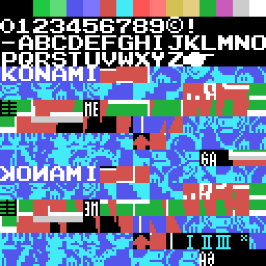
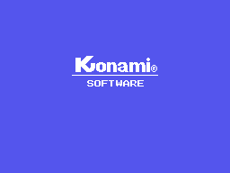

# Findings

What turned up when we took it apart, with the measurement next to each thing.

## The right half of the table is not stored

The routine at 0x7060 copies from VRAM to VRAM passing each byte through
0x47A6, which reverses its eight bits:

    L_47A6: push bc / ld c,a / ld b,008h
    L_47AA: rr c / rla / djnz L_47AA
            pop bc / ret

Out of the right of C and into the left of A: the tile backwards. And the loop
that calls it, at 0x703B, **restores the source with a `pop` on every pass and
only advances the destination**, so the same chunk is mirrored into all three
thirds of the screen.

That is 768 bytes mirrored on the court and 512 more on the title background.
You can see it in the pattern sheet:

Where the first third reads **KONAMI**, the mirror reads **IMANOK**.

## The cartridge defends itself: copy protection

Two instructions in the start-up write inside the cartridge itself:

- **0x4013** puts a `pop hl` and a `ret` over the `djnz` at 0x40EE.
  The `0xC9` it writes is a `ret`, and it does not invent that either: it
  reads it from somewhere else in its own ROM.
- **0x4052** leaves a zero at 0x40F8, which is not data: it is the operand of
  the `jp` at 0x40F7. In memory that turns it into `jp 00000h`, a dead reset.

**Neither of them does anything here.** The cartridge runs from ROM, and ROM takes no
writes: that is why they look like dead code. They are not. A pirated cartridge is a
copy loaded into **RAM**, and there the write does land and breaks the game.
Doing nothing on the original is exactly the point.

This is no one-off idea in this cartridge: the same pair —a write over a `djnz`
and another over the operand of a `jp`— turns up in nine cartridges of this series, always in the same two start-up routines, and the second one alone in one more. **Manuel Pazos** identified
them in his disassembly of RC-727, where he named them `ReadKeys_AC` and
`VRAM_writeAC`.

## Every frame carries the pointer to its patterns right behind it

The second decompressor, 0x5E9B, starts like this:

    inc hl / ld e,(hl) / inc hl / ld d,(hl) / ex de,hl    HL = the block
    ld e,(hl) / inc hl / ld d,(hl) / ex de,hl / inc de    HL = the destination

It is not handed the block: it **fetches it from a pointer**, and that pointer
sits right behind each frame's sprite data. A frame is therefore:

    [dy, dx, pattern] per sprite, an 0x81 if it uses fewer, and the pointer

That accounts for the 3,135 bytes of 0x73A7..0x7D25, and it checks out **two
independent ways**:

1. chaining blocks with the decompressor from 0x73A7, the chain lands
   **exactly** on 0x7D26 -where the next block starts, already known from
   elsewhere- in forty steps
2. and the forty pointers held by the frames of both tables are, one by one,
   those forty starts

Twenty frames for the near player, drawn with up to five sprites, and twenty
for the far one, drawn with two or three.

## The whole of table tennis scoring, in BCD

The score is kept in binary-coded decimal -0x6760 adds with
`add a,001h / daa`- and, read that way, the rules come out complete:

| rule | where |
|---|---|
| a game is won at 21 | `cp 021h` at 0x6891 |
| if both reach 21, the score resets | 0x6829 |
| deuce at 20-all | `cp 020h` at 0x6819 |
| the service changes every five points | 0x683D |
| ends change at 10 in the deciding game | 0x46C8 |

The service change is the neatest: 0x683D **adds both scores**, runs `daa` and
checks whether the units digit is 0 or 5.

And the two-point-lead check accepts 0x02 **and also 0x08**. That is not a bug:
the subtraction is binary over BCD, so 21 minus 19 gives 0x08 and is still two
points. The two shapes a two-point gap can take, depending on whether there is
a nibble carry.

## A sine table, and both sine and cosine come out of it

0x6EAD is 92 bytes that climb from 12 to 255, come back down, pass through zero
and climb again. That it is a sine is measured: the 31 values of the first
quarter against 255·sin(i·90/31) are off by **4.7 at most**, over a range of
255.

And the two places that read it -0x6E99 and 0x6EA3- sit **31 entries apart**,
which is exactly a quarter of a wave. One table gives both functions.

## A label interpreter with four doors

The two things that can vary are whether the destination is read from the
script or arrives in HL, and whether the mask lets the bytes through or writes
zeros. All four combinations have their own entry, and they take ten bytes
between them:

    0x4764  ld c,0ffh  falling into 0x4766   header yes, paints
    0x476C  straight into the loop           header no
    0x475C  ld c,0ffh / jr 0x476C            header no, paints
    0x4760  ld c,000h / jr 0x4766            header yes, ERASES

With the mask at zero the `and c` leaves the byte at zero: **the very script
that wrote the label erases it**, keeping its shape.

## The company logo is not an image

0x4A2F draws it one row higher on each pass -0xFFE0 is minus 0x20- and on each
one lays down three runs of **consecutive** patterns: three from 0x40, eleven
from 0x43 and twelve from 0x4E, plus twelve zeros that wipe the previous pass.

Fourteen passes, starting from the bottom row.

## Two writes that go nowhere

0x4013 writes to 0x40EE and 0x4052 to 0x40F8. Both addresses fall **inside the
ROM itself**, which cannot be written: the two `ld`s run on every game and
change nothing.

## The same skeleton as Road Fighter

Not similar: the same, piece by piece. The dispatcher with the table glued
behind it, the two 8-over-16-bit adds, the label interpreter, the decompressor
and its thirds loop.

And the **eight VDP register bytes are identical**, one by one:
`02 E2 0E 7F 07 76 03 E4`. There they live at 0x46A9 and here at 0x47D6. VRAM
being the other way round is therefore not a finding of this cartridge: it is
one more piece of the skeleton the two of them share.

## What was hard to catch

Four drawing errors that **looking at the picture did not catch**, and that
only came out from comparing byte for byte against the emulator's VRAM:

1. 0x48A6 loads `hl,00008h`, which in this layout is the **COLOUR** table: the
   fifteen tiles it fills are flat rectangles of colour, and that is where the
   court's red floor comes from. Read as patterns, the screen came out black.
2. The title screen **inherits the logo's VRAM**; between screens only the name
   table is cleared. Starting from zero gave 1,113 differing bytes.
3. R7 is 0xE4 -blue background- during the logo and 0xE0 afterwards.
4. The **"O" in PONG is a sprite**, not a tile: two same-coloured sprites in
   the same place. Without painting them, the logo came out with a gap.

After all four, the logo and the table match the emulator's VRAM with **zero
bytes different**, and the title screen with just one, the eighth of the small
"KONAMI": the dump catches that animation half-way through.
