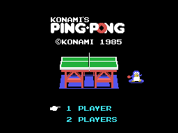
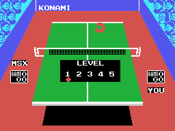
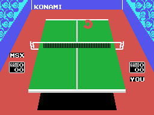

# El juego

Konami's Ping Pong es tenis de mesa visto desde detrás de un jugador, con la
mesa en perspectiva y el rival al fondo. Salió en 1985 como cartucho RC-731 de
16 KB para MSX1.

## Uno o dos jugadores

La pantalla de título ofrece las dos opciones, y el cursor las recorre. Lo que
se elige queda en un solo bit: (0xE042) indexa una tabla de dos bytes -0x40 y
0x60- y el que salga va a (0xE002). **El bit 5 de ese byte es lo único que el
resto del juego mira** para saber si enfrente hay una persona o la máquina.

## Cinco niveles

El menú de nivel se pinta encima de la mesa ya montada.

Los cinco valores que ofrece -1, 3, 5, 7 y 9- están en la tabla de 0x461F, y
el cursor es el patrón 0x88 puesto en la columna que ella dice. Por dentro el
nivel es el índice, de 0 a 4.

El nivel no cambia la velocidad de la pelota: cambia **cómo juega la máquina**.
Entra en tres sitios distintos:

- en la tabla de trayectorias, que dice adónde devuelve la pelota
- en el umbral de puntos a partir del cual empieza a apretar
- y en el nivel más fácil, en un pestillo que le hace fallar una de cada dos

En la demostración que corre sola, el nivel no es el elegido: es el **3 fijo**,
que lo pone 0x40A9.

## Las reglas son las de verdad

Están enteras dentro del cartucho, y se leen en el código porque el tanteo va
en BCD:

- el set se gana a **21**
- hay que **ganar por dos**, y si los dos llegan a 21 el marcador se reinicia
- **deuce** al empate a 20
- el **saque cambia cada cinco puntos**, mirando el dígito de las unidades de
  la suma de los dos tanteos
- y en el tercer set se **cambia de campo a los 10**

La partida es al mejor de tres sets. Los ordinales que anuncian cada uno -1ST,
2ND y 3RD- están guardados como tres guiones de seis bytes.

## Lo que canta el árbitro

Cuatro rótulos, elegidos por el estado del punto: **LET**, **NET**, **OUT** e
**IN**. Cada uno tiene su melodía en una tabla hermana, indexada por el mismo
número.

Y los demás textos que el cartucho lleva escritos: LOVE ALL, GAME, DEUCE,
GAME SET, WIN, CHANGE COURT y LEVEL.

## El cambio de campo

Cuando toca cambiar de lado, el cartucho no mueve a los jugadores: **permuta
los mandos**. 0x46EB intercambia los dos bytes de mando de un jugador con los
del otro, y a partir de ahí cada uno maneja al muñeco del otro lado.

## La mesa

Se dibuja media y la otra media sale de reflejarla. La imagen de arriba está
montada ejecutando en Python los mismos pasos que corre el cartucho, y no se
diferencia en **ni un byte** de la que el emulador tiene en su VRAM.
